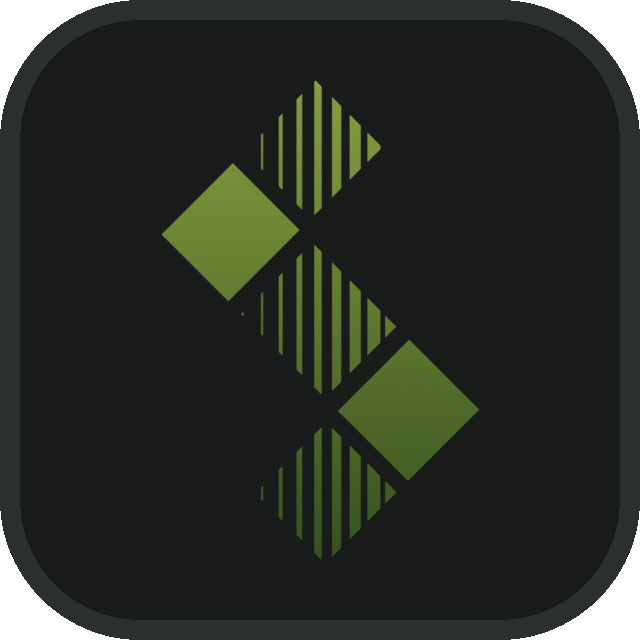

### ** Samer Mobasery**

I've built software for very different environments - from industrial HMI systems and internal desktop tools to production web applications and backend services.

That range shapes how I approach engineering: understanding how the pieces fit together, solving practical problems, and building software that holds up beyond the initial implementation.

*I design it. I refine it. I build it.*

Website: [samer.cx](https://samer.cx)

<picture>
  <source media="(prefers-color-scheme: dark)" srcset="assets/editorial-rule.svg">
  
</picture>

### Technologies

**Professional**

- **Web & backend:** TypeScript / JavaScript · React · Node.js / Express · MongoDB
- **Desktop & HMI:** Python / PySide2 · C++ / Qt / QML

**University**
- Java · C/C++ · R
